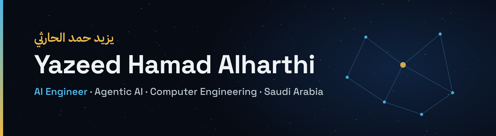

  

  
  

I build **AI systems that can be trusted**: agents that cite their sources, say when they do not
know, and leave the final decision to a human. Most of my work is Arabic-first and aimed at real
Saudi problems: heritage tourism, healthcare revenue, disaster risk and Islamic education.

أبني أنظمة ذكاء اصطناعي **يُعتمد عليها**: وكلاء يوثّقون مصادرهم، ويعترفون إذا ما عندهم دليل، ويتركون القرار الأخير للإنسان.
أغلب شغلي عربي أولًا، ويستهدف مشاكل سعودية حقيقية.

## Highlights

- **1st Place, Smart Tourism AI Champions Challenge 2026.** Tuwaiq Academy × Google for Developers, with project [AURA](https://github.com/4-u1/AURA).
- **SDAIA Academy, Advanced Agentic AI Systems Engineering.** Capstone: [MIJHAR](https://github.com/4-u1/mijhar-agent), an evidence-audit agent with a signed human gate.
- **AI for Islamic Content Challenge 2026 (Bathel).** AI Solutions Engineer on [ILM](https://github.com/4-u1/ILM-AI).
- **Team Lead, NEX Team.** Google × Tuwaiq track, with Mishari Khalid Al Osaimi.

## Featured projects

<table>
<tr>
<td width="50%" valign="top">

<b><a href="https://github.com/4-u1/AURA">AURA · أورا</a></b> 
AI digital twin of At-Turaif, Diriyah. Generative and predictive AI for smart heritage tourism. <b>1st place.</b>
</td>
<td width="50%" valign="top">

<b><a href="https://github.com/4-u1/mijhar-agent">MIJHAR · مِجهر</a></b> 
Evidence-audit agent on a governed LangGraph pipeline with MCP tools. Evals 73% → 100%, nothing written without a human signature.
</td>
</tr>
<tr>
<td width="50%" valign="top">

<b><a href="https://github.com/4-u1/ILM-AI">ILM · عِلم</a></b> · <a href="https://weilmai.ai.studio/">live</a> 
Islamic learning and dawah platform. RAG grounded in verified sources, with a hard guardrail against AI fatwas.
</td>
<td width="50%" valign="top">

<b><a href="https://github.com/4-u1/Mirsad">Mirsad · مِرصاد</a></b> · <a href="https://mirsad-rho.vercel.app">live</a> 
Landslide-risk prediction for southwest Saudi Arabia on an interactive sector map. I built the GIS cell grid.
</td>
</tr>
<tr>
<td width="50%" valign="top">

<b><a href="https://github.com/4-u1/Mujeaz">Mujeaz · مُجاز</a></b> 
Revenue assurance and prior authorization for Saudi healthcare (NPHIES). Predicts denials and builds cited appeals for human review.
</td>
<td width="50%" valign="top">

<b>VORQEN</b> · <a href="https://vorqen-pi.vercel.app">live</a> 
Contextual-memory assistant that links what you share over time and answers with sources and confidence. Arabic voice. In progress.
</td>
</tr>
</table>

## Tech I work with

**AI & agents** 

**Backend & data** 

**Frontend & delivery** 

## How I build

- **The model extracts, code decides.** Dates, permissions and citations are checked in plain code, not left to the model.
- **A human signs off.** Anything that writes, sends or acts waits for approval.
- **Measured, not claimed.** Evaluation sets and tests come before the demo.
- **Arabic first.** RTL interfaces, Gulf Arabic and Saudi context from day one.

---

NEX Team · <i>Beyond the expected</i>

