

  

  

  
  
  
  

---

## About me

I am a Computer Engineering student and AI engineer from Saudi Arabia. I build **AI systems that
can be trusted**: agents that show where every claim came from, admit when the evidence is not
there, and wait for a human before anything is written, sent or decided.

My projects target real Saudi sectors (heritage tourism, healthcare revenue cycles, judicial
asset liquidation, disaster risk, public-sector indicators and Islamic education) and are
**Arabic-first** from the interface to the voice.

مهندس ذكاء اصطناعي وطالب هندسة حاسب من السعودية. أبني أنظمة ذكاء اصطناعي **يُعتمد عليها**: وكلاء يوثّقون مصدر كل معلومة، ويعترفون إذا ما عندهم دليل، وينتظرون موافقة الإنسان قبل أي قرار.
مشاريعي موجّهة لقطاعات سعودية حقيقية، وعربية أولًا من الواجهة إلى الصوت.

**Right now**

- Building **VORQEN**, a contextual-memory assistant with Arabic voice ([live demo](https://vorqen-pi.vercel.app)).
- Taking **MIRAAH** through the Ibtikar Infath program with my team, NEX.
- Leading **NEX Team** in the Google × Tuwaiq track.

## Achievements & programs

| Year | Program | Result | Project |
| :--- | :--- | :--- | :--- |
| 2026 | **Smart Tourism AI Champions Challenge** · Tuwaiq Academy × Google for Developers | **1st Place** · Team Lead | [AURA](https://github.com/4-u1/AURA) |
| 2026 | **Advanced Agentic AI Systems Engineering** · SDAIA Academy | Capstone · sole author | [MIJHAR](https://github.com/4-u1/mijhar-agent) |
| 2026 | **Developing Generative AI Solutions** · SDAIA Academy | Certificate · team project | [DealGuard](https://github.com/4-u1/dealguard) |
| 2026 | **AI for Islamic Content Challenge** · Bathel Initiative | NEX entry · AI Solutions Engineer | [ILM](https://github.com/4-u1/ILM-AI) |
| 2026 | **HackerRank Orchestrate** · October contest | Solo submission | [GDDA](https://github.com/4-u1/GDDA-agent) |
| 2026 | **Ibtikar Infath** · Qassim University × Infath | In progress · NEX Team | [MIRAAH](https://github.com/4-u1/MIRAAH-Al) |

## Featured

<table>
<tr>
<td width="50%" valign="top">
<a href="https://github.com/4-u1/AURA">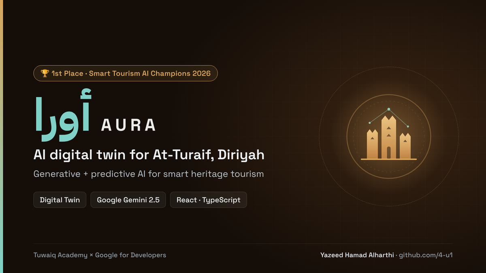</a>
<h3><a href="https://github.com/4-u1/AURA">AURA · أورا</a></h3>
AI digital twin of At-Turaif in Diriyah, a UNESCO World Heritage site. Generative and predictive AI for visitor flow and smart heritage tourism.  
<b>1st Place</b> · Smart Tourism AI Champions 2026 
React · TypeScript · Gemini 2.5 Pro &amp; Flash
</td>
<td width="50%" valign="top">
<a href="https://github.com/4-u1/mijhar-agent">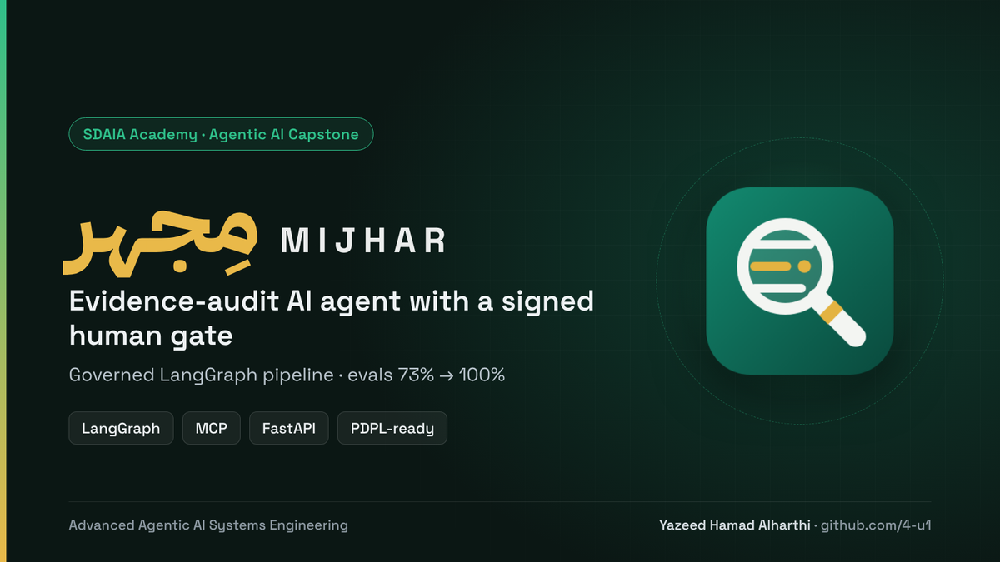</a>
<h3><a href="https://github.com/4-u1/mijhar-agent">MIJHAR · مِجهر</a></h3>
Evidence-audit agent that drives a governed LangGraph pipeline over MCP tools. Nothing is written without a signed human decision; governance lives in code, not prompts.  
<b>Evals 73% → 100%</b> · <a href="https://4-u1.github.io/mijhar-agent/slides/">65-slide deck</a> 
Python · LangGraph · MCP · FastAPI · OpenRouter
</td>
</tr>
</table>

## Healthcare

<table>
<tr>
<td width="33%" valign="top">
<a href="https://github.com/4-u1/Mujeaz">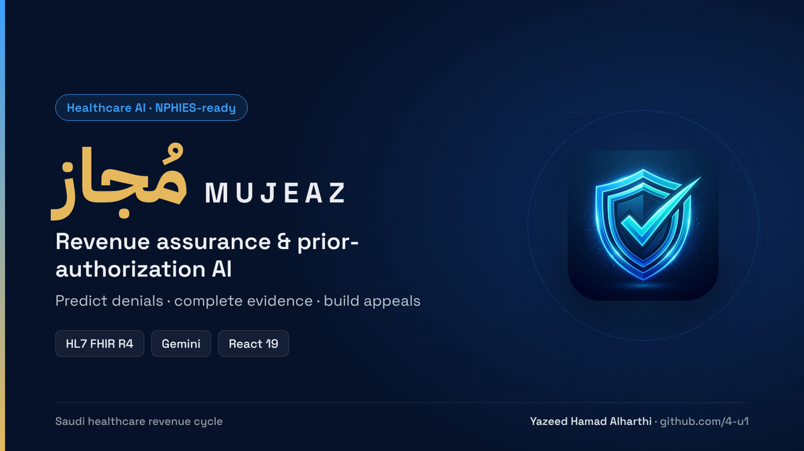</a>
<b><a href="https://github.com/4-u1/Mujeaz">Mujeaz · مُجاز</a></b> 
Revenue assurance and prior authorization for NPHIES. Predicts denials, completes evidence, builds cited appeals. 
React 19 · Gemini · HL7 FHIR R4
</td>
<td width="33%" valign="top">
<a href="https://github.com/4-u1/Afiya-care-platform">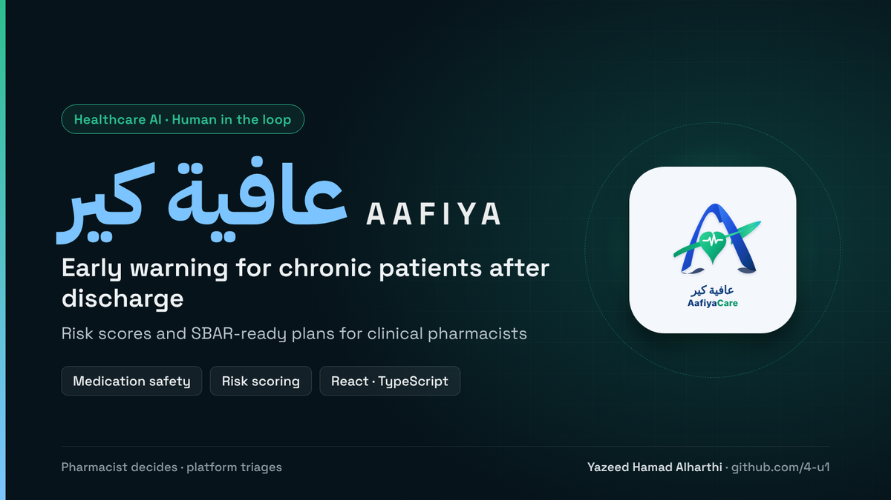</a>
<b><a href="https://github.com/4-u1/Afiya-care-platform">AafiyaCare · عافية كير</a></b> 
Early warning for chronic patients after discharge: risk scores and SBAR-ready plans for clinical pharmacists. 
Medication safety · Risk scoring
</td>
<td width="33%" valign="top">
<a href="https://wanisai-senior-cognitive-intelligence-467968797278.europe-west2.run.app">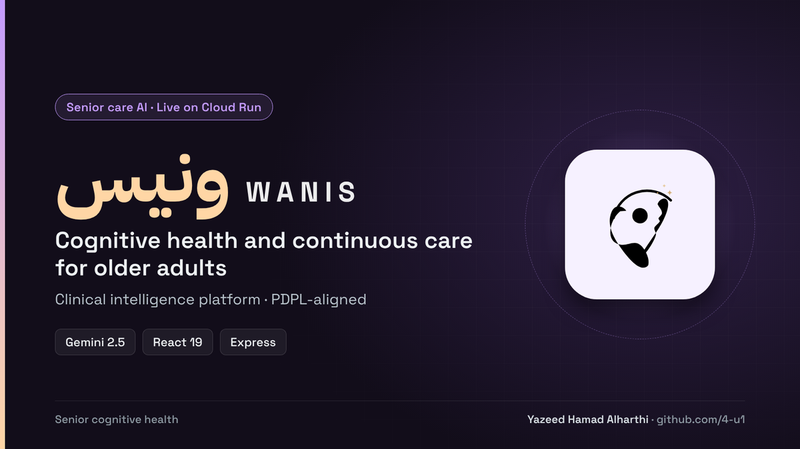</a>
<b><a href="https://github.com/4-u1/WANIS-AI">WANIS · ونيس</a></b> · <a href="https://wanisai-senior-cognitive-intelligence-467968797278.europe-west2.run.app">live</a> 
Cognitive health and continuous care platform for older adults. 
Gemini 2.5 · React 19 · Cloud Run
</td>
</tr>
</table>

## Public sector & safety

<table>
<tr>
<td width="33%" valign="top">
<a href="https://github.com/4-u1/MIRAAH-Al">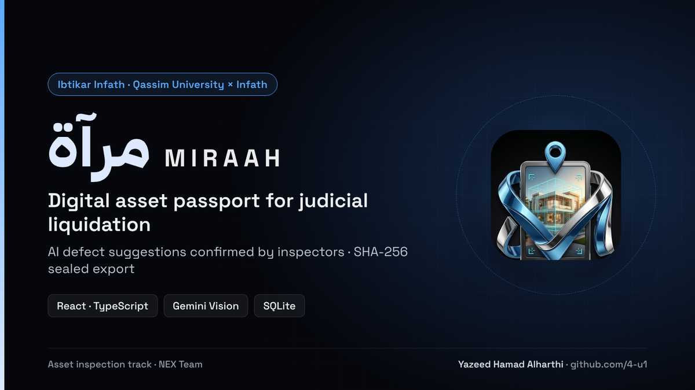</a>
<b><a href="https://github.com/4-u1/MIRAAH-Al">MIRAAH · مرآة</a></b> 
Digital asset passport for judicial liquidation. AI defect suggestions confirmed by inspectors, SHA-256 sealed export. 
React · Gemini Vision · SQLite
</td>
<td width="33%" valign="top">
<a href="https://mirsad-rho.vercel.app">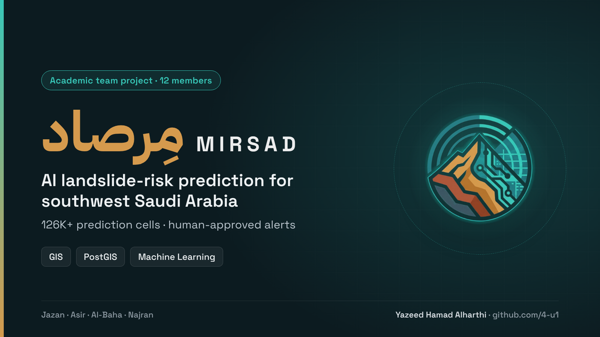</a>
<b><a href="https://github.com/4-u1/Mirsad">Mirsad · مِرصاد</a></b> · <a href="https://mirsad-rho.vercel.app">live</a> 
Landslide-risk prediction for southwest Saudi Arabia with human-approved alerts. I built the GIS cell grid. 
PostGIS · Supabase · ML
</td>
<td width="33%" valign="top">
<a href="https://github.com/4-u1/marsad-platform">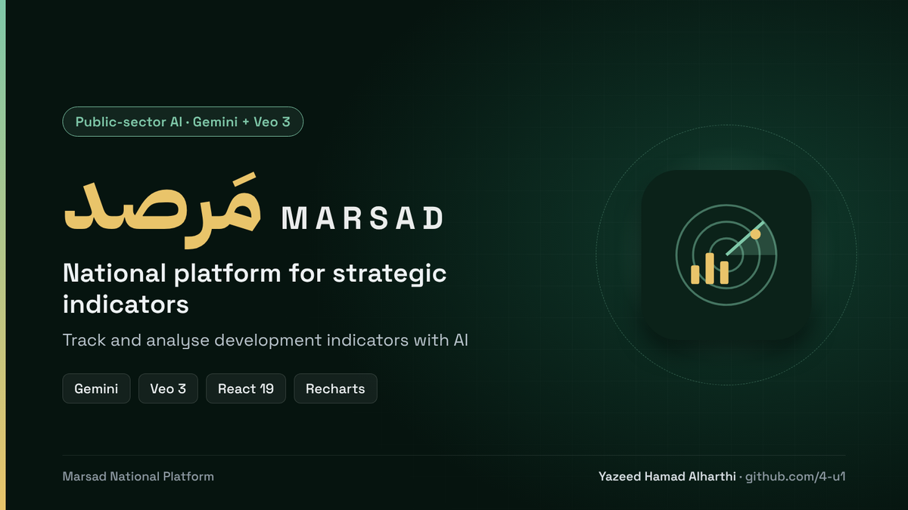</a>
<b><a href="https://github.com/4-u1/marsad-platform">Marsad · مَرصد</a></b> 
National platform for tracking and analysing strategic and development indicators with AI. 
Gemini · Veo 3 · React 19 · Recharts
</td>
</tr>
</table>

## Trust, memory & data

<table>
<tr>
<td width="33%" valign="top">
<a href="https://vorqen-pi.vercel.app">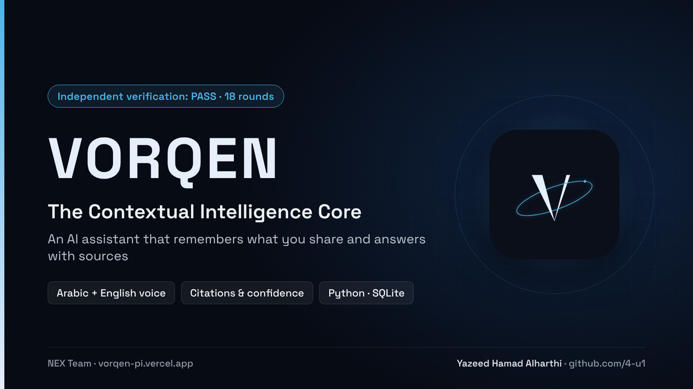</a>
<b>VORQEN</b> · <a href="https://vorqen-pi.vercel.app">live</a> 
Assistant that links what you share over time and answers with sources and confidence. Passed 18 rounds of independent verification. 
Python · SQLite · Arabic voice
</td>
<td width="33%" valign="top">
<a href="https://github.com/4-u1/GDDA-agent">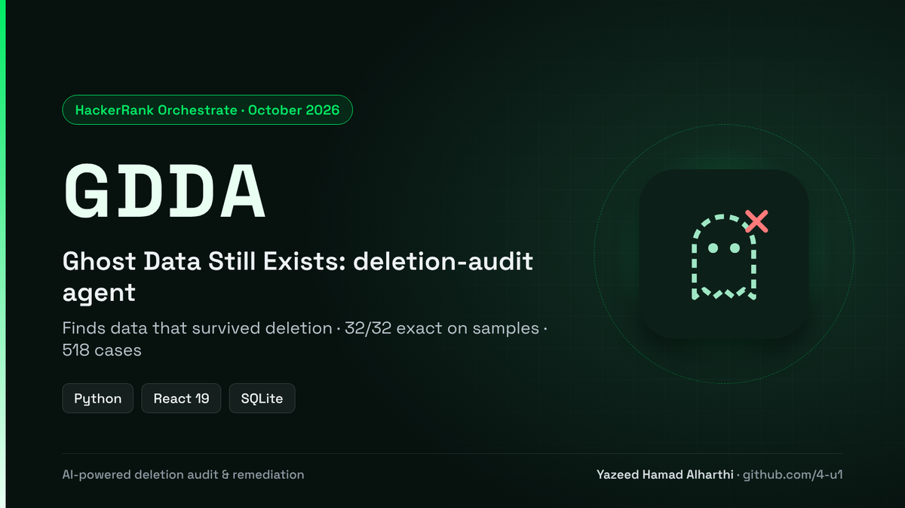</a>
<b><a href="https://github.com/4-u1/GDDA-agent">GDDA · Ghost Data Still Exists</a></b> 
Deletion-audit and remediation agent that finds data surviving deletion. 32/32 exact on samples, 518 evaluation cases. 
Python · React 19 · SQLite
</td>
<td width="33%" valign="top">
<a href="https://dealguard-a7k8.onrender.com/">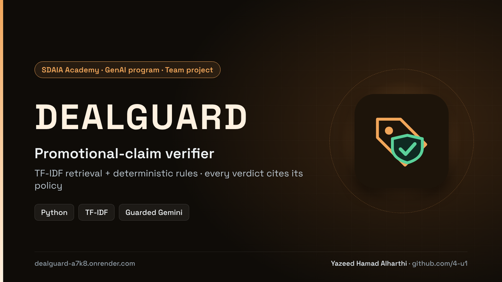</a>
<b><a href="https://github.com/4-u1/dealguard">DealGuard</a></b> · <a href="https://dealguard-a7k8.onrender.com/">live</a> 
Promotional-claim verifier: retrieval plus deterministic rules, every verdict cites its policy. Team project. 
Python · TF-IDF · guarded Gemini
</td>
</tr>
</table>

## Learning & content

<table>
<tr>
<td width="50%" valign="top">
<a href="https://weilmai.ai.studio/">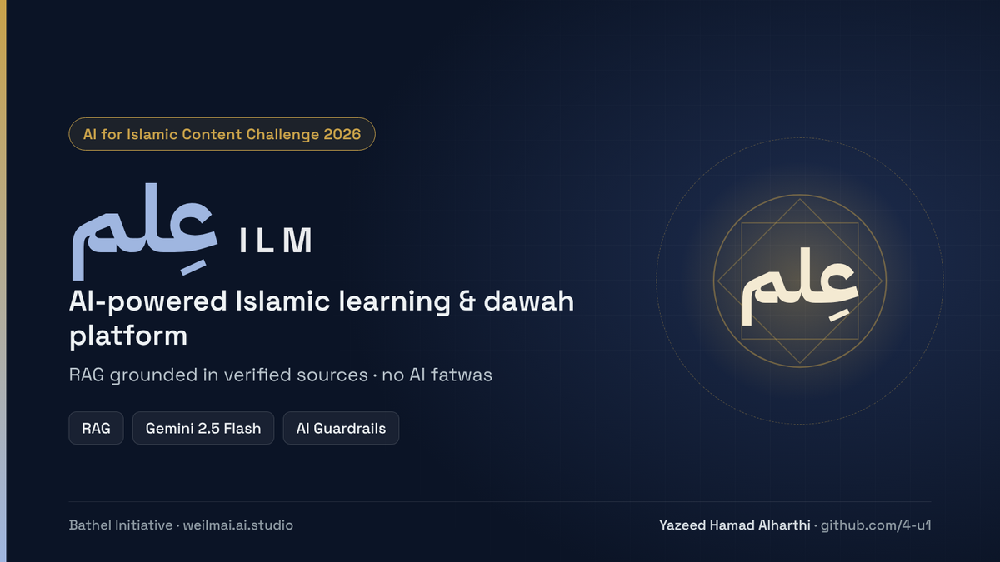</a>
<b><a href="https://github.com/4-u1/ILM-AI">ILM · عِلم</a></b> · <a href="https://weilmai.ai.studio/">live</a> 
Islamic learning and dawah platform with personalised journeys. RAG grounded in verified sources, with a hard guardrail against AI fatwas. 
RAG · Gemini 2.5 Flash · TypeScript
</td>
<td width="50%" valign="top">
<a href="https://yad-qtk.pages.dev">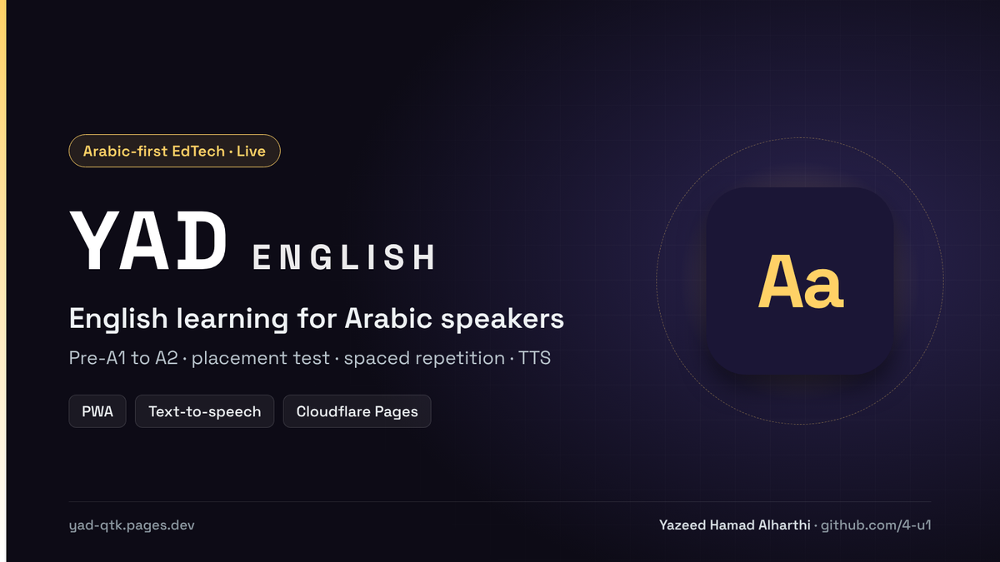</a>
<b>YAD English</b> · <a href="https://yad-qtk.pages.dev">live</a> 
English learning for Arabic speakers from Pre-A1 to A2: placement test, spaced repetition, text-to-speech and an interactive roadmap. 
PWA · TTS · Cloudflare Pages
</td>
</tr>
</table>

## All projects at a glance

| Project | Domain | What it does | Status |
| :--- | :--- | :--- | :--- |
| [AURA](https://github.com/4-u1/AURA) | Heritage & tourism | AI digital twin of At-Turaif, Diriyah | 1st Place |
| [MIJHAR](https://github.com/4-u1/mijhar-agent) | Agentic AI | Evidence-audit agent with a signed human gate | Capstone · CI |
| [VORQEN](https://vorqen-pi.vercel.app) | Personal AI | Contextual memory with sources and confidence | Live · in progress |
| [ILM](https://github.com/4-u1/ILM-AI) | Islamic education | Grounded learning and dawah platform | Live |
| [Mirsad](https://github.com/4-u1/Mirsad) | Disaster risk | Landslide susceptibility map and alerts | Live · finished |
| [MIRAAH](https://github.com/4-u1/MIRAAH-Al) | Judicial liquidation | Digital asset passport for inspections | MVP |
| [Mujeaz](https://github.com/4-u1/Mujeaz) | Healthcare revenue | Prior authorization and denial recovery | Prototype |
| [AafiyaCare](https://github.com/4-u1/Afiya-care-platform) | Clinical pharmacy | Post-discharge risk triage | Prototype |
| [WANIS](https://github.com/4-u1/WANIS-AI) | Senior care | Cognitive health and continuous care | Live |
| [Marsad](https://github.com/4-u1/marsad-platform) | Public sector | National indicators with AI analysis | Prototype |
| [GDDA](https://github.com/4-u1/GDDA-agent) | Data privacy | Deletion-audit and remediation agent | Contest entry |
| [DealGuard](https://github.com/4-u1/dealguard) | Consumer trust | Promotional-claim verifier | Live · team |
| [YAD English](https://yad-qtk.pages.dev) | EdTech | English for Arabic speakers, Pre-A1 to A2 | Live |

## Tech stack

   
  

| Area | Tools |
| :--- | :--- |
| **Agents & orchestration** | LangGraph · Model Context Protocol (MCP) · tool calling · human-in-the-loop gates |
| **Models** | Google Gemini · Anthropic Claude · OpenAI · OpenRouter · Hugging Face |
| **Retrieval & grounding** | RAG · TF-IDF · pgvector · citation validation · abstention |
| **Evaluation** | Frozen eval sets · graders · baseline comparison · adversarial verification |
| **Voice & vision** | Azure Speech · Gemini TTS · Gemini Vision · OCR (Tesseract) |
| **Geospatial & health data** | PostGIS · GIS grids · HL7 FHIR R4 · NPHIES workflows |
| **Automation** | n8n · GitHub Actions |

## How I build

| Principle | In practice |
| :--- | :--- |
| **The model extracts, code decides** | Dates, money, permissions and citations are checked in plain code, never left to the model. |
| **A human signs off** | Anything that writes, sends or acts waits for approval: signed gates in MIJHAR, inspector confirmation in MIRAAH, approved alerts in Mirsad. |
| **Measured, not claimed** | Evaluation sets and tests come before the demo. MIJHAR: 73% → 100%. VORQEN: 800+ tests and 18 verification rounds. |
| **Privacy by default** | No capture without an explicit action, audit logs for every change, PDPL in mind. |
| **Arabic first** | RTL interfaces, Gulf Arabic, Arabic voice and Saudi context from day one. |

---

  <b>NEX Team</b> · <i>Beyond the expected</i> 
  <a href="https://www.linkedin.com/in/y4z">LinkedIn</a> · <a href="mailto:yazed.501k@gmail.com">Email</a> · <a href="https://github.com/4-u1">github.com/4-u1</a>

